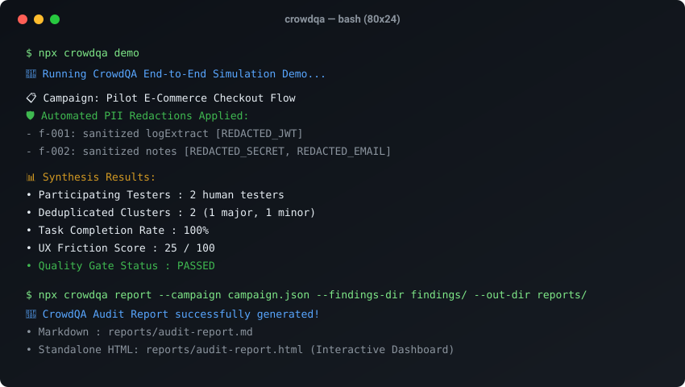

# CrowdQA

<p align="center">
  <a href="https://github.com/MRJonam91/CrowdQA/actions/workflows/ci.yml"></a>
  <a href="LICENSE"></a>
  <a href="https://nodejs.org"></a>
  <a href="package.json"></a>
  <a href="https://github.com/sponsors/MRJonam91"></a>
</p>

> **Motore per test umani e crowd testing strutturato: orchestrazione campagne, accordi di consenso/NDA con firma crittografica, anonimizzazione automatica dati sensibili (PII), clustering anomalie e report di audit sintetico.**

[English](README.md) · [Architettura](docs/ARCHITECTURE.md) · [Esempio Report](examples/sample-audit-report.md) · [Roadmap](docs/ROADMAP.md) · [Checklist Lancio](docs/LAUNCH.md)

<p align="center">
  
</p>

---

## 🎯 Il Problema

I piccoli team di sviluppo, i freelance e le startup bootstrapped incontrano enormi difficoltà a ottenere **test umani strutturati e ripetibili**:
- I test browser automatizzati (Playwright, Cypress) coprono l'happy path e le regressioni, ma non rilevano frizioni reali di navigazione, glitch di layout su dispositivi mobili, rage click o incomprensioni d'interfaccia.
- I test beta informali generano screenshot disordinati scambiati su Slack o email, spesso esponendo credenziali di test, token di sessione o dati personali.
- Le piattaforme commerciali di crowd testing impongono costosi abbonamenti enterprise, lunghe trattative commerciali e lock-in proprietario.

**CrowdQA** offre un motore open source e a zero dipendenze esterne per orchestrare sessioni di QA umano: definizione degli scenari di test su molteplici viewport, generazione di accordi NDA e consenso informato firmati con hash SHA-256, bonifica automatica dei log da segreti o PII, clustering intelligente dei bug duplicati e compilazione di report professionali in Markdown, JSON e dashboard HTML interattiva.

---

## 🚀 Avvio rapido​‌​​‌‌​‌​‌​‌​​‌​​‌​​‌​‌​​​‌‌‌​​‌​​‌‌​​​‌​​‌​‌‌​‌​‌‌​​​‌‌​‌‌‌​​‌​​‌‌​‌‌‌‌​‌‌‌​‌‌‌​‌‌​​‌​​​‌‌‌​​​‌​‌‌​​​​‌​​‌​‌‌​‌​​‌‌‌​​​​‌‌​​‌​​​​‌‌​‌​​​​‌‌​​‌​​‌‌​​‌​‌​​‌‌​​​‌

Esegui la simulazione end-to-end con dati di esempio in un solo comando:

```bash
npx crowdqa demo
```

Oppure organizza la tua prima campagna di test in tre passaggi:

```bash
# 1. Inizializza il file dichiarativo della campagna
npx crowdqa init "checkout-flow"

# 2. Genera e firma crittograficamente l'NDA / consenso per il tester
npx crowdqa consent --tester "tester-alicia" --campaign "campaign-checkout-flow"

# 3. Sintetizza i risultati in report Markdown, JSON e HTML interattivo
npx crowdqa report --campaign crowdqa.campaign.json --findings-dir findings/ --out-dir reports/
```

---

## ✨ Funzionalità Chiave

- 📱 **Matrice Viewport e Persona**: Scenari guidati configurabili per desktop, viewport mobili (iPhone 390px, Android 360px) e profili di utente diversificati.
- 📜 **Consenso Informato e NDA Crittografico**: Genera accordi di riservatezza e autorizzazione al test firmati con hash crittografico SHA-256 a prova di manomissione.
- 🛡️ **Bonifica Dati Sensibili (Zero-Leak PII Scrub)**: Regex engine incorporato che rileva e oscura automaticamente Bearer token, JWT, API key, password, indirizzi email e numeri di carte di credito nei log e nei passaggi di riproduzione.
- 🔍 **Clustering e Deduplicazione**: Raggruppa segnalazioni simili inviate da tester diversi su piattaforme differenti, assegnando automaticamente la gravità più elevata.
- 📊 **Sintesi Multi-Formato**: Genera riassunti Markdown per PR GitHub, JSON per gate automatici in CI/CD, e una dashboard HTML autonoma con grafici SVG priva di qualsiasi CDN esterno.
- ⚡ **Zero Dipendenze a Runtime**: Realizzato esclusivamente con moduli nativi Node.js (>= 22.18) per massima velocità, sicurezza e portabilità.

---

## 💻 Riferimento Comandi CLI

| Comando | Descrizione |
|---|---|
| `crowdqa init [nome]` | Crea lo scheletro dichiarativo `crowdqa.campaign.json` |
| `crowdqa check --campaign <file>` | Esegue il linting e valida requisiti viewport e quality gates |
| `crowdqa consent --tester <id> --campaign <id>` | Genera e firma l'accordo di riservatezza per il tester |
| `crowdqa submit --file <path.json> \| --dir <cartella>` | Valida le segnalazioni e anonimizza i dati sensibili |
| `crowdqa cluster --findings-dir <dir>` | Raggruppa e deduplica le anomalie raccolte |
| `crowdqa report --campaign <file> --findings-dir <dir>` | Compila i report di audit in Markdown, JSON e HTML |
| `crowdqa export --report <file.json> --format <sarif\|junit\|csv\|issues>` | Esporta i risultati in SARIF 2.1.0, JUnit XML, CSV o issue GitHub |
| `crowdqa badge --report <file.json> [--out <file.svg>]` | Genera il badge SVG dinamico del punteggio CrowdScore™ per README / PR |
| `crowdqa serve --report <path.html> [--port 3000]` | Avvia un server locale per visualizzare il report HTML interattivo |
| `crowdqa verify --report <file>` | Verifica la firma di provenienza e i criteri di qualità |
| `crowdqa doctor` | Esegue il controllo diagnostico su runtime, permessi e ambiente |
| `crowdqa demo` | Esegue una simulazione completa con tester e anomalie d'esempio |

---

## 🏛️ Architettura e Guardia Dimensionale

Il codice di business logic in `src/core/` è mantenuto volutamente snello (tassativamente inferiore a 1.500 righe non vuote) e verificato in CI:
- `src/core/campaign.ts`: Validazione schema e valutazione quality gates
- `src/core/consent.ts`: Consenso informato e firma accordo SHA-256
- `src/core/sanitizer.ts`: Anonimizzazione e oscuramento PII/segreti
- `src/core/findings.ts`: Validazione e clustering semantico anomalie
- `src/core/report.ts`: Calcolo metriche e render report Markdown/HTML

Consulta il documento completo in [`docs/ARCHITECTURE.md`](docs/ARCHITECTURE.md).

---

## 💖 Supporto e Donazioni

CrowdQA è software libero rilasciato sotto licenza **AGPL-3.0-only**. Se questo strumento è utile al tuo team o ai tuoi progetti di sviluppo, puoi sostenere lo sviluppo continuo con una donazione:

- **GitHub Sponsors:** [sponsor @MRJonam91](https://github.com/sponsors/MRJonam91)
- **Ko-fi:** [ko-fi.com/mrjonam](https://ko-fi.com/mrjonam)
- **Buy Me a Coffee:** [buymeacoffee.com/mrjonam](https://buymeacoffee.com/mrjonam)
- **PayPal:** [paypal.me/manorollo](https://paypal.me/manorollo)

---

## ⚖️ Licenza e Attribuzione

- **Open Source:** Distribuito con licenza [GNU Affero General Public License v3.0](LICENSE) (`AGPL-3.0-only`).
- **Licenza Commerciale:** Per piattaforme SaaS proprietarie, portali enterprise interni o agenzie white-label senza obblighi di copyleft, è disponibile una licenza commerciale separata. Consulta [COMMERCIAL-LICENSE.md](COMMERCIAL-LICENSE.md).
- **Contributi:** I contributi richiedono l'accettazione del [Contributor License Agreement](CLA.md).
- **Documentazione:** Rilasciata sotto licenza [CC BY-SA 4.0](https://creativecommons.org/licenses/by-sa/4.0/).
- Copyright (C) 2026 Manoj Rollo ([@MRJonam91](https://github.com/MRJonam91)). Dettagli completi in [LICENSING.md](LICENSING.md).
