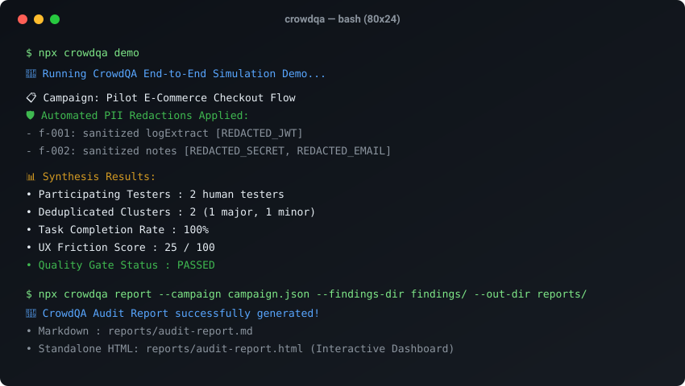

# CrowdQA

<p align="center">
  <a href="https://github.com/MRJonam91/CrowdQA/actions/workflows/ci.yml"></a>
  <a href="LICENSE"></a>
  <a href="https://nodejs.org"></a>
  <a href="package.json"></a>
  <a href="https://github.com/sponsors/MRJonam91"></a>
</p>

> **Structured crowd testing and human QA engine: campaign orchestrator, tester consent/NDA generator, automated PII scrubbing, bug clustering, and audit report synthesis.**

[Italiano](README.it.md) · [Architecture](docs/ARCHITECTURE.md) · [Sample Report](examples/sample-audit-report.md) · [Roadmap](docs/ROADMAP.md) · [Launch Checklist](docs/LAUNCH.md)

<p align="center">
  
</p>

---

## 🎯 The Problem

Small software teams, indie developers, and bootstrapped startups struggle to obtain **structured, reproducible human testing**:
- Automated browser tests (Playwright, Cypress) verify happy paths and regression, but miss real human friction, awkward mobile layouts, rage clicks, and edge-case confusion.
- Informal beta tests yield unstructured screenshots dumped in Slack or email threads, often leaking private customer tokens, test credentials, or PII.
- Commercial crowd testing platforms require expensive multi-seat monthly subscriptions, enterprise sales calls, and rigid proprietary vendors.

**CrowdQA** provides an open source, zero-dependency engine to orchestrate targeted human QA missions: define explicit user flows across viewports, generate binding tester NDA/consent agreements, automatically redact secrets and personal data, cluster duplicate findings across devices, and compile clean audit reports in Markdown, JSON, and standalone HTML.

---

## 🚀 Quick start​‌​​‌‌​‌​‌​‌​​‌​​‌​​‌​‌​​​‌‌‌​​‌​​‌‌​​​‌​​‌​‌‌​‌​‌‌​​​‌‌​‌‌‌​​‌​​‌‌​‌‌‌‌​‌‌‌​‌‌‌​‌‌​​‌​​​‌‌‌​​​‌​‌‌​​​​‌​​‌​‌‌​‌​​‌‌‌​​​​‌‌​​‌​​​​‌‌​‌​​​​‌‌​​‌​​‌‌​​‌​‌​​‌‌​​​‌

Run the built-in end-to-end simulated crowd testing demo in seconds:

```bash
npx crowdqa demo
```

Or initialize your first campaign in three simple steps:

```bash
# 1. Scaffold a test campaign definition
npx crowdqa init "checkout-flow"

# 2. Generate a cryptographically signed tester NDA / informed consent
npx crowdqa consent --tester "tester-alicia" --campaign "campaign-checkout-flow"

# 3. Synthesize findings into Markdown, JSON, and interactive HTML
npx crowdqa report --campaign crowdqa.campaign.json --findings-dir findings/ --out-dir reports/
```

---

## ✨ Key Features

- 📱 **Multi-Device Viewport & Persona Matrix**: Declare test missions targeting desktop, mobile viewports (e.g. 390px iPhone, 360px Android), and distinct tester demographics (first-time shoppers, power users).
- 📜 **Cryptographic Consent & NDA Engine**: Generates binding informed consent and non-disclosure terms signed with tamper-evident SHA-256 hashes.
- 🛡️ **Zero-Leak Automated PII Redaction**: Automatically scrubs Bearer tokens, JWTs, API keys, credentials, email addresses, and credit card patterns from evidence logs before intake.
- 🔍 **Deduplicated Finding Clustering**: Groups similar issues reported across different testers and devices into consolidated defect clusters with escalated severity.
- 📊 **Multi-Format Synthesis**: Generates structured Markdown summaries for GitHub PRs, machine-readable JSON for CI/CD gates, and rich, self-contained interactive HTML dashboards with inline SVG charts.
- ⚡ **Zero Runtime Dependencies**: Built with native Node.js (>= 22.18) modules (`node:crypto`, `node:fs`, `node:path`), ensuring instant startup and zero supply-chain risk.

---

## 💻 CLI Reference

| Command | Description |
|---|---|
| `crowdqa init [name]` | Scaffold a new declarative `crowdqa.campaign.json` |
| `crowdqa check --campaign <file>` | Lint and validate campaign setup, viewports, and quality gates |
| `crowdqa consent --tester <id> --campaign <id>` | Generate and cryptographically sign tester NDA |
| `crowdqa submit --file <path.json> \| --dir <folder>` | Validate finding(s) and sanitize PII from evidence |
| `crowdqa cluster --findings-dir <dir>` | Group and deduplicate findings across crowd submissions |
| `crowdqa report --campaign <file> --findings-dir <dir>` | Generate Markdown, JSON, and HTML audit reports |
| `crowdqa export --report <file.json> --format <sarif\|junit\|csv\|issues>` | Export audit findings to SARIF 2.1.0, JUnit XML, CSV, or GitHub Issues |
| `crowdqa badge --report <file.json> [--out <file.svg>]` | Generate embeddable CrowdScore™ SVG badge for README / PRs |
| `crowdqa serve --report <path.html> [--port 3000]` | Host local interactive preview server for HTML audit report |
| `crowdqa verify --report <file>` | Verify report cryptographic signature and quality gates |
| `crowdqa doctor` | Run diagnostic pre-flight health checks on runtime & environment |
| `crowdqa demo` | Run full simulation with sample testers and findings |

---

## 🏛️ Architecture & Core Size Guard

The core business logic in `src/core/` is intentionally kept compact (under 1,500 non-empty lines) and verified in CI:
- `src/core/campaign.ts`: Campaign validation and quality gate evaluator
- `src/core/consent.ts`: Informed consent and SHA-256 agreement signing
- `src/core/sanitizer.ts`: Privacy regex engine for automated PII scrub
- `src/core/findings.ts`: Finding validation, normalization, and semantic clustering
- `src/core/report.ts`: Metric computation, Markdown, and standalone HTML generation

Read the full architecture guide in [`docs/ARCHITECTURE.md`](docs/ARCHITECTURE.md).

---

## 💖 Support & Donations

CrowdQA is free software developed under the **AGPL-3.0-only** license. If this tool saves your team time or enhances your QA process, consider supporting ongoing development:

- **GitHub Sponsors:** [sponsor @MRJonam91](https://github.com/sponsors/MRJonam91)
- **Ko-fi:** [ko-fi.com/mrjonam](https://ko-fi.com/mrjonam)
- **Buy Me a Coffee:** [buymeacoffee.com/mrjonam](https://buymeacoffee.com/mrjonam)
- **PayPal:** [paypal.me/manorollo](https://paypal.me/manorollo)

---

## ⚖️ License & Attribution

- **Open Source:** Distributed under the [GNU Affero General Public License v3.0](LICENSE) (`AGPL-3.0-only`).
- **Commercial License:** For proprietary SaaS deployments, closed enterprise developer portals, or white-label QA agencies without copyleft obligations, a separate commercial license is available. See [COMMERCIAL-LICENSE.md](COMMERCIAL-LICENSE.md).
- **Contributions:** Contributions require accepting the [Contributor License Agreement](CLA.md).
- **Documentation:** Licensed under [CC BY-SA 4.0](https://creativecommons.org/licenses/by-sa/4.0/).
- Copyright (C) 2026 Manoj Rollo ([@MRJonam91](https://github.com/MRJonam91)). See [LICENSING.md](LICENSING.md).
